# Diagramas — Gestor de Gastos

Diagramas em [Mermaid](https://mermaid.js.org/), renderizados direto pelo GitHub. Decisões de fundo: [plano](plano.md) e [ADRs](adr/).

1. [Arquitetura](#1-arquitetura)
2. [Repositórios e dependências](#2-repositórios-e-dependências)
3. [Cadastro e confirmação de e-mail](#3-cadastro-e-confirmação-de-e-mail)
4. [Login e chamada autenticada](#4-login-e-chamada-autenticada)
5. [Lançar gasto](#5-lançar-gasto)
6. [Dashboard (dados de tela)](#6-dashboard-dados-de-tela)
7. [Admin bloqueia usuário](#7-admin-bloqueia-usuário)
8. [Exclusão de usuário (evento)](#8-exclusão-de-usuário-evento)
9. [Ciclo de vida do usuário](#9-ciclo-de-vida-do-usuário)
10. [Navegação entre telas](#10-navegação-entre-telas)
11. [Modelo de dados](#11-modelo-de-dados)
12. [CI/CD e ordem de deploy](#12-cicd-e-ordem-de-deploy) (inclui deploy por OIDC)

---

## 1. Arquitetura

Só o BFF é público. Os microserviços são invocados via IAM (ADR 0004) e cada um é dono da sua tabela (ADR 0002).

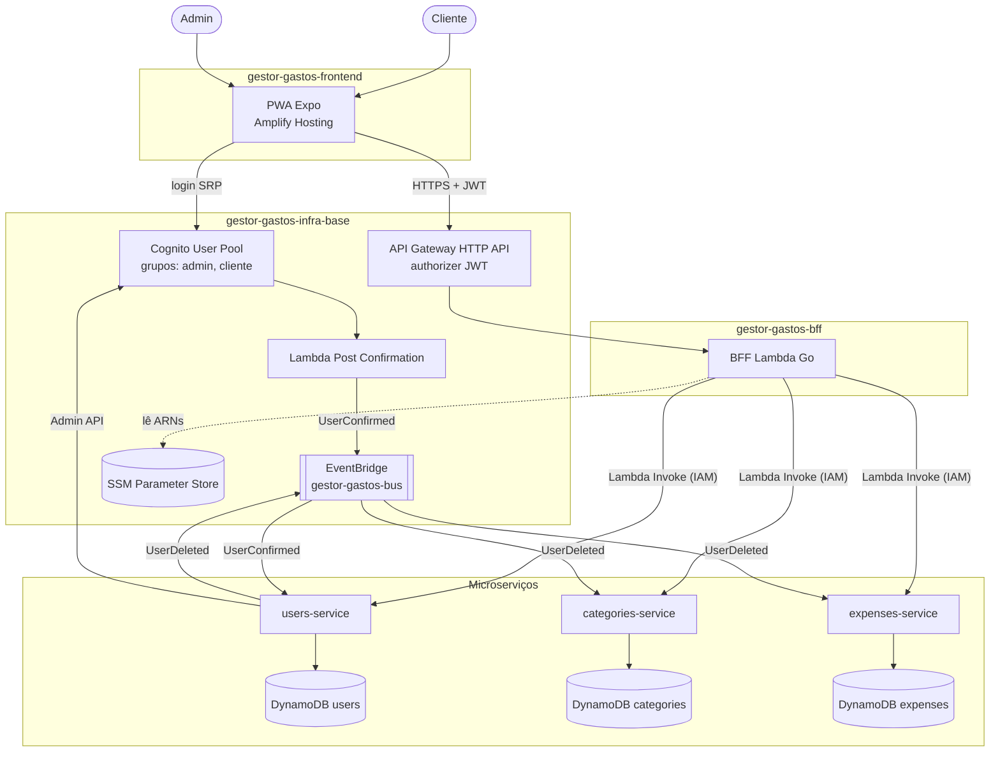

## 2. Repositórios e dependências

Os repositórios não dependem de código uns dos outros, só de parâmetros (SSM), do contrato (OpenAPI) e da lib versionada (ADR 0006).

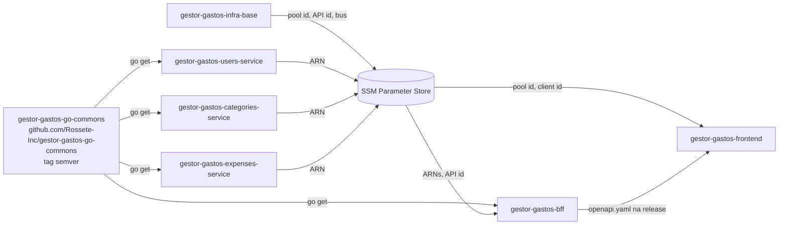

## 3. Cadastro e confirmação de e-mail

O trigger fica no `infra-base`, que sobe antes dos serviços. Por isso ele não chama o `users-service` direto: ele publica um evento.

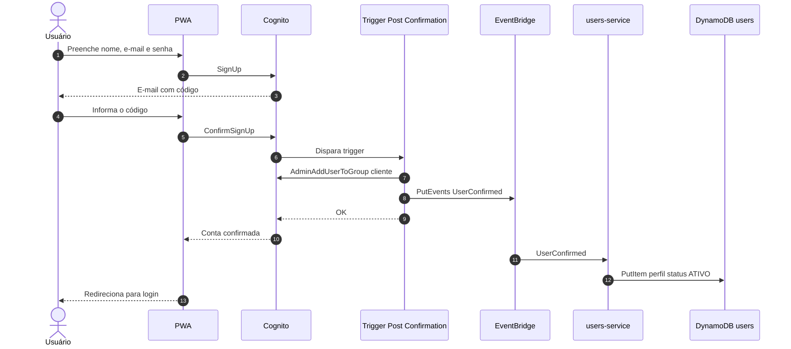

## 4. Login e chamada autenticada

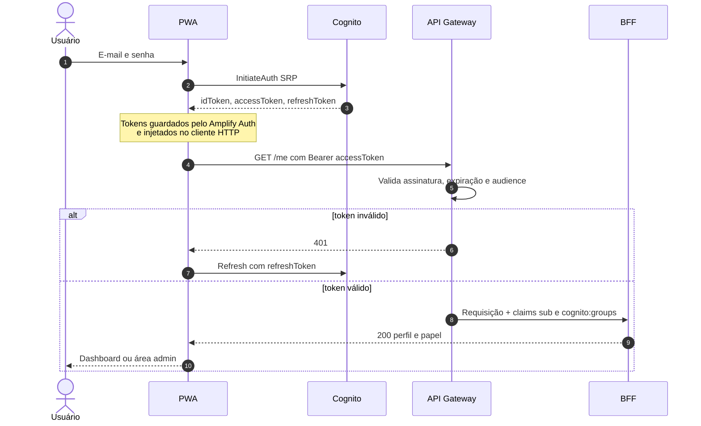

## 5. Lançar gasto

O BFF valida se a categoria existe e pertence ao usuário ou ao sistema. O `expenses-service` sempre grava sob o `userId` vindo do token, nunca do corpo da requisição.

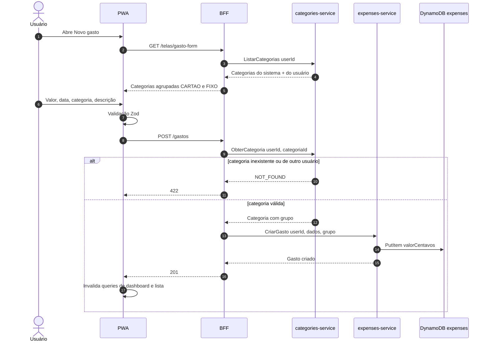

## 6. Dashboard (dados de tela)

O BFF chama os serviços em paralelo e devolve a tela pronta: o front não junta dados.

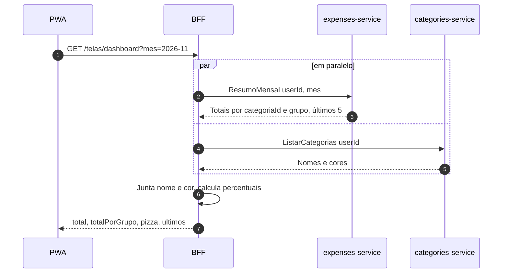

## 7. Admin bloqueia usuário

Autorização em duas camadas: o BFF exige o grupo `admin`, e o `users-service` revalida o papel do chamador.

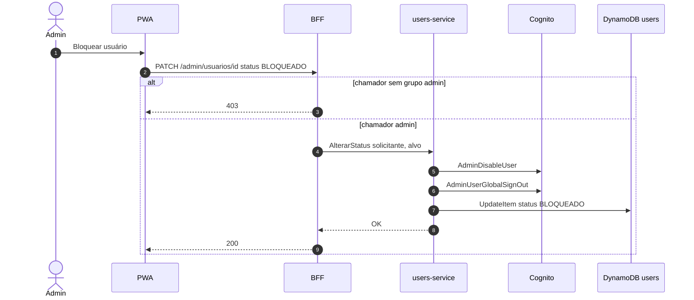

## 8. Exclusão de usuário (evento)

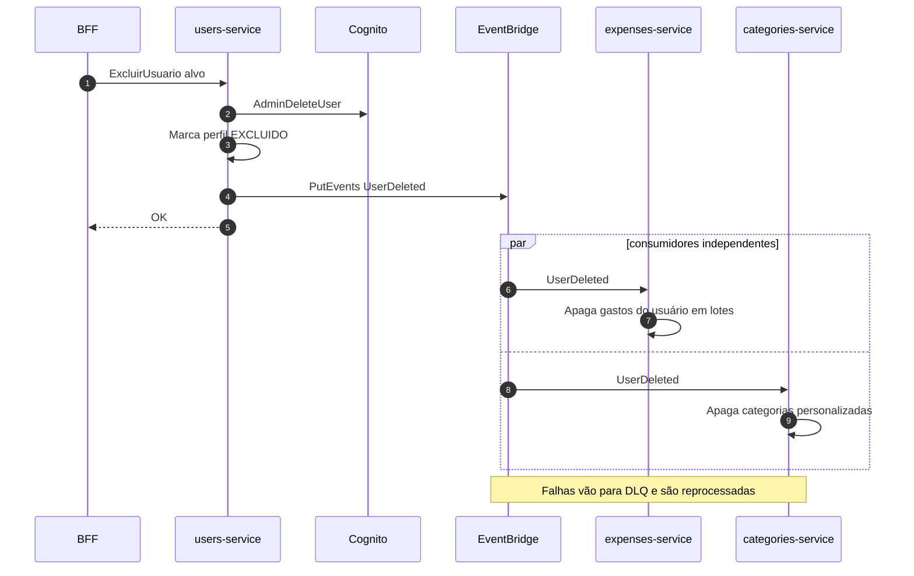

## 9. Ciclo de vida do usuário

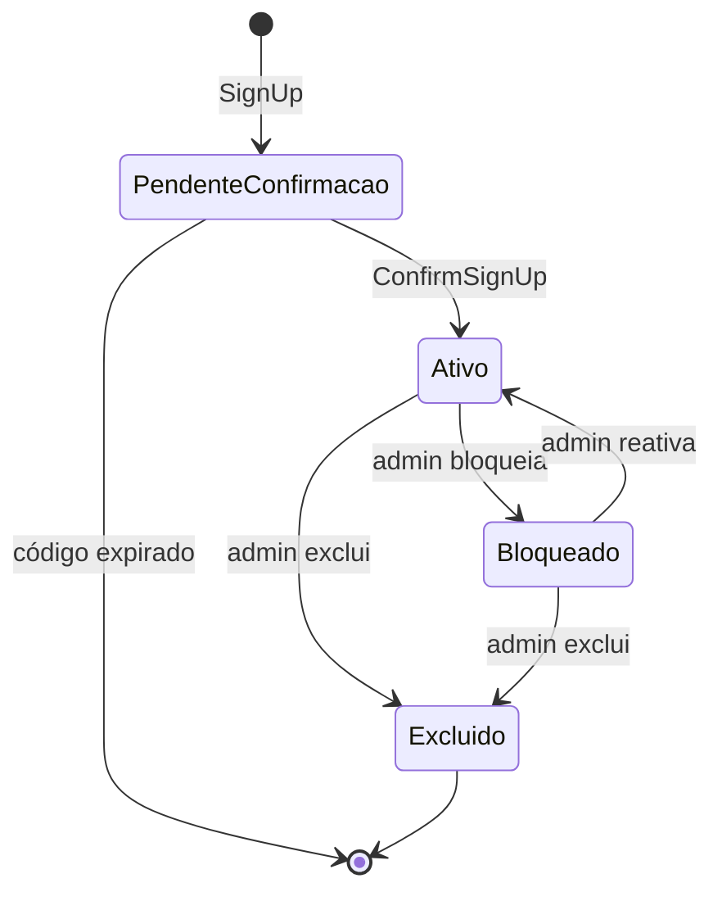

## 10. Navegação entre telas

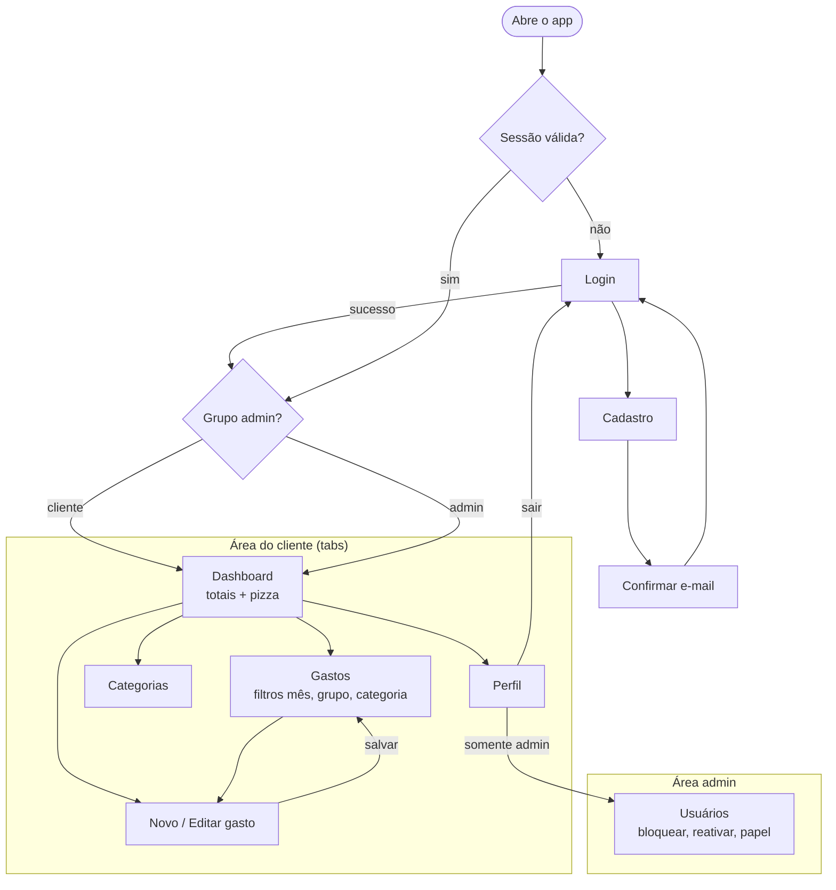

## 11. Modelo de dados

Visão lógica. Cada entidade fica numa tabela de um serviço diferente, então as relações são **por ID**, sem chave estrangeira. As chaves físicas estão no [plano](plano.md#microserviços-e-dados-dynamodb-single-table-por-serviço).

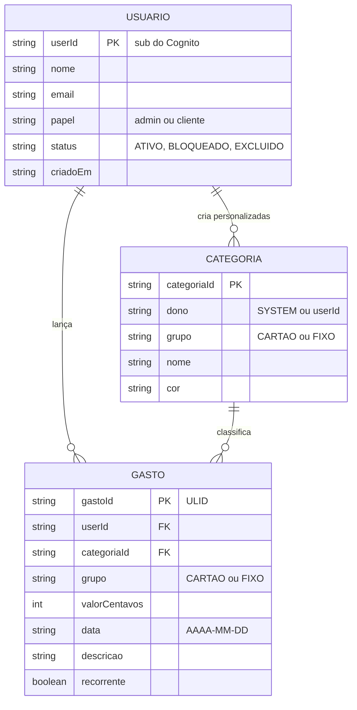

## 12. CI/CD e ordem de deploy

Todo deploy na AWS é automático (ADR 0007). A nuvem tem um ambiente só, `dev`, e tags não fazem deploy. A ordem só importa no primeiro deploy, por causa dos parâmetros no SSM.

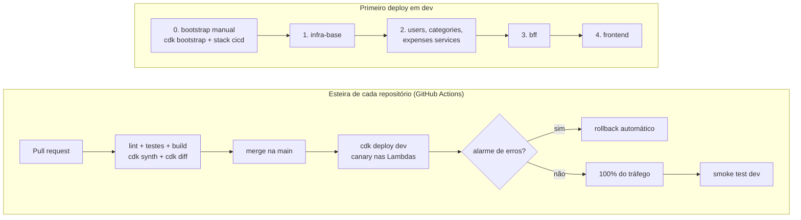

### Deploy autenticado por OIDC

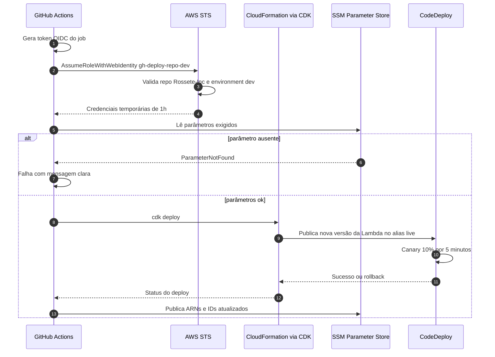
